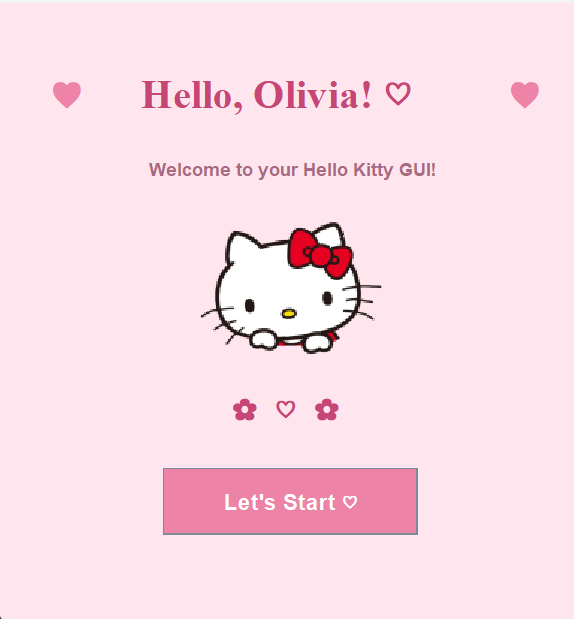

# 🎀 Hello Kitty Java GUI

A cute Hello Kitty-inspired desktop application built using Java Swing. This project was created to practice Java programming, graphical user interface design, and event handling.

## 💗 Features

- Pastel pink background and custom styling
- Hello Kitty character image
- Personalized welcome message
- Interactive button displaying a welcome popup
- Decorative hearts 

## 💻 Technologies Used

- Java
- Java Swing
- Java AWT
- Visual Studio Code
- Git and GitHub

## 📸 Screenshot

## 🚀 How to Run

1. Install the Java Development Kit (JDK).
2. Clone or download this repository.
3. Open the project folder in VS Code.
4. Run `HelloKittySimpleGUI.java`.

## 🧠 What I Learned

Through this project, I practiced:

- Creating desktop applications with Java Swing
- Using JFrame, JLabel, JButton, and ImageIcon
- Positioning GUI components with setBounds()
- Customizing colors, fonts, and layouts
- Handling button clicks with ActionListener
- Managing and uploading projects using Git and GitHub

## 🌸 Future Improvements

- Add multiple screens and navigation
- Create a to-do list
- Add a study timer
- Implement more interactive decorations

---

*This is an independent educational project inspired by Hello Kitty and is not affiliated with Sanrio.*
